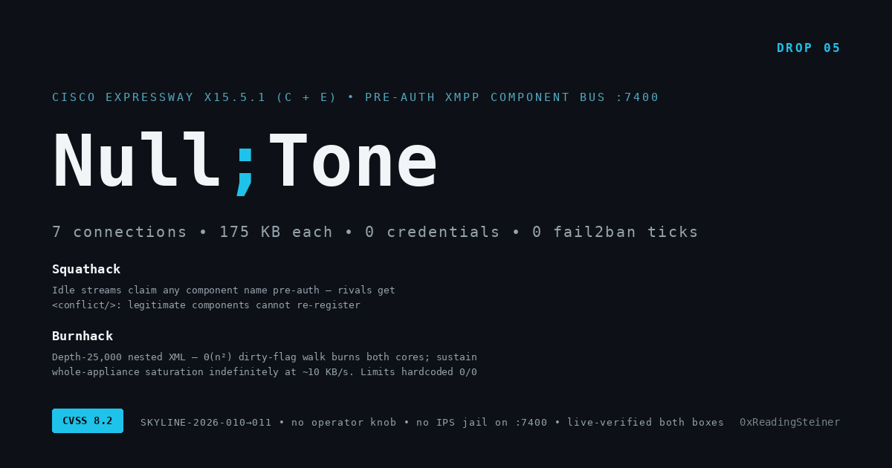

# Null;Tone

**Pre-authentication full-appliance XMPP saturation and component-bus takeover on Cisco Expressway — both C and E**

Seven connections. 175 KB each. No credentials, no crash, no ban. The edge that carries every remote worker's calls and messages goes quiet — and the appliance's own defenses never see it happen.

---

## Kill Chain

| Step | Component | Description |
|------|-----------|-------------|
| 1 | **Squathack** | Any idle, header-only stream on :7400 claims its `to=` name with **zero authentication**. Rival handshakes — including legitimate internal components reconnecting — receive `<conflict/>` instantly. Live pre-flight: **10/10 arbitrary names accepted** on both boxes; no registry knowledge required |
| 2 | **Burnhack** | A 175 KB depth-25,000 nested-XML stream costs seconds of CPU because the node implementation walks the **full ancestor chain on every append** (`_setDirty`, Θ(n²) — 91.5% of burn CPU in one function). Accept-side limits are **hardcoded 0/0**: no operator knob exists |
| 3 | *(saturation)* | 7 concurrent streams (the daemon's thread count) pin **both vCPUs** of the standard 2-core appliance. New-stream handshakes degrade from 0.01 s to **12–18 s** with 30 s+ timeouts. All XMPP/MRA routing on the box stalls for the volley — sustained indefinitely at **~10 KB/s** with drain-driven re-firing |
| ★ | *(invisibility)* | No fail2ban jail covers :7400 on either box (jails watch 22, 80/443, 5060–5062, 5222, 8443, 2222). No rate limit. No alarm. The only telemetry is the daemon's CPU ticks climbing ~90–220 CPU-seconds per volley |

## Verification

Live-verified **2026-10-05 on two real production-version appliances** (Expressway-C and Expressway-E, X15.5.1, 2 vCPU/4 GB), single bracketed volleys with full pre/post attestation:

| Box | ΔCPU (daemon) | Peak probe degradation | Recovery | Post-state |
|-----|---------------|------------------------|----------|------------|
| Expressway-E | +218.6 CPU-s (both cores ~90% through a 121 s window) | 0.00 s → **18.18 s** | t=121 s, baseline ×3 | pid continuous, kernel log clean, 0 established, 0 bans |
| Expressway-C | +92 CPU-s (both cores ~98% across a 47 s drain) | 0.00 s → **13.09 s** | t=91 s | pid continuous, clean, 0 bans |

Indefinite sustained saturation (drain-driven re-fire, 678 s continuous at ~98.5% both cores, service state never recovering while the loop ran) verified on an isolated production-equivalent clone. The daemon never crashes — this is resource exhaustion, not corruption; recovery is immediate when the attacker stops.

## Impact

- **Mute the collaboration edge.** On Expressway-E of an MRA deployment, that port's daemon services every remote worker's messaging path. One host on any segment that can route to :7400 degrades all of it, for as long as it wants.
- **Choose the duration.** Single volley = 45–240 s of saturation. Sustained loop = indefinite, at trivial bandwidth cost.
- **Own the bus across restarts.** Squatted names mean even a service restart window doesn't restore legitimate component registration.
- **Stay invisible.** No jail, no rate limit, no alarm; well-formed XMPP to a legitimate service port.

## Proof of Concept

```
./poc.sh <expressway-host> [port=7400]        # full 7-stream volley — IMPACTFUL, authorized targets only
./poc.sh <expressway-host> 7400 --solo        # single stream, depth 10000 — shows the superlinear
                                              # CPU cost without saturating; safest verifier
```

Measurement-first: baseline RTT probes → volley → per-30 s degradation probes → recovery confirmation. Attacker-side sockets only; **zero state left on the target** (verified: daemon pid continuous, connection table clean, kernel log clean, zero IPS ticks). Requires python3.

## Components

| ID | Name | CWE | CVSSv3.1 | Title |
|----|------|-----|----------|-------|
| SKYLINE-2026-010 | **Squathack** | CWE-306 | 5.3 | Pre-auth component-name claim on the externally bound XCP bus |
| SKYLINE-2026-011 | **Burnhack** | CWE-400 / CWE-407 | 7.5 | Θ(n²) unbounded-depth parse saturation, limits hardcoded 0/0 |

**Chain CVSSv3.1:** 8.2 (High) — `AV:N/AC:L/PR:N/UI:N/S:U/C:N/I:L/A:H` (composed; I:L = registration blocking)

## Mitigation (no patch exists)

**Filter TCP :7400 everywhere.** Shipped components in X15.5.1 are in-process modules — the listener has zero legitimate external consumers. Full defender playbook (audit commands, detection signatures, IR steps): [mitigations.md](mitigations.md).

## Files

- [ADVISORY.md](ADVISORY.md) — full technical advisory (root cause, measurements, PoC walkthrough, remediation)
- [poc.sh](poc.sh) — research PoC (`--solo` safe-verifier mode included)
- [mitigations.md](mitigations.md) — defender playbook

## Coordination

Cisco PSIRT unresponsive since 2026-08-04 across all channels (direct, ZDI ×17 submissions, SSD — paused pending Cisco). MITRE CVE requests submitted under the CNA-of-last-resort process at publication. Full history: [cisco-security-research/TIMELINE.md](https://github.com/0xReadingSteiner/cisco-security-research/blob/main/TIMELINE.md).

## Legal

Independent research on legally owned lab appliances running production-version software. No proprietary access, no customer systems. Live fires performed under controlled, bracketed conditions with immediate recovery confirmation. Advisory text CC BY 4.0; PoC for defensive and educational use.

**0xReadingSteiner** — 0xReadingSteiner@proton.me
